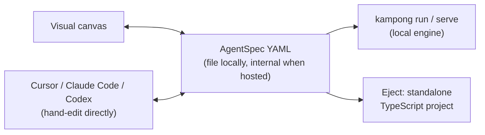

# Kampong Agents

https://github.com/user-attachments/assets/319eee49-3011-483b-8494-850d78a9a550

Design an agent workflow on a visual canvas, or hand-write it in Cursor or Claude Code. Either way
you get one YAML file that is always safe to commit, diff and review. Run it locally against any
model (including offline Ollama), put it on a schedule or a webhook, and when you're done, eject it
to a standalone TypeScript project with no dependency on this tool.



## What you can build

- **Agent workflows** with tools, guardrails and human approval (Slack or terminal). One agent per spec today.
- **Unattended pipelines:** a `schedule`, `poll` or authenticated `webhook` trigger, `foreach` loops that survive
  bad items, `branch`/`stop`, `transform`/`validate`/`dedupe` data steps, structured model output.
- **First-party connectors** for Slack, Gmail, GitHub, Supabase and Alpha Vantage, and a pinned,
  digest-checked component model for your own.
- **Templates to start from:** `market-etl`, a scheduled price pipeline that runs offline on recorded fixtures, and
  `support-triage`, an inbox assistant that drafts replies for a person to send, and `webhook-triage`, an alert
  webhook where a model decides and a person approves the Slack post.

## Status

Early, but real. The MVP (canvas/YAML duality, local engine with guardrails and approvals, CLI with
mock/record tools and Ollama, TypeScript export) and the real-world workflow layer (webhooks, connectors,
Slack approvals) are merged. The scheduling, data-step and component work is landing now. A hosted,
multi-tenant server exists but is not deployed yet. Multi-agent orchestration, enterprise governance and
natural-language generation are roadmap. [`SLICES.md`](./SLICES.md) has the per-slice status.

## Quick start

Needs Node 22 or newer. Just want to look? `make try-demo` opens the canvas on the `market-etl` template, ready to
Replay, with no keys and no Docker (`make try` starts on an empty folder; `make try-reset` clears both).

```sh
npm install
npm run build
npm link -w packages/cli                               # puts `kampong` on your PATH

cp .env.example .env                                   # then set OPENROUTER_API_KEY (free tier works)
kampong run examples/agent.yaml --input "Hi, what can you do?"
kampong dev examples                                   # the canvas, at http://localhost:4310
```

No key? `kampong templates` lists the ready-made specs, and the `market-etl` template runs on recorded
data: see its [`README`](./packages/cli/templates/market-etl/README.md). In the canvas, the empty state and
**New from template** in the menu list them too; choosing one copies the spec and its recorded data and opens it.

## Usage

```sh
kampong dev [dir]                       # canvas (YAML in a "</>" drawer, Alt+Y, lines follow the selected node); edits the file on disk
                                        # shortcuts: Ctrl/Cmd+K command palette, / step search, Alt+Y YAML drawer
kampong run agent.yaml --input "..."    # headless run; --tools replay for offline, --approve-all for CI
kampong serve agent.yaml                # webhook, scheduled or polling service (POST /webhook, run-now)
kampong export agent.yaml ./out         # standalone TypeScript project: cd ./out && npm install && npm start
kampong doctor agent.yaml               # preflight: components, credentials, fixtures
```

Run `kampong dev` in an empty folder and the canvas opens a "Start a new workflow" screen; **Start blank**
creates `agent.yaml` then.

On the canvas, click a node to edit it in the side panel (`Esc` closes, `Delete` removes, `Ctrl/Cmd+D` duplicates). Each form has Setup, Output, Test and Settings tabs.
Add a step from the palette on the left (search, or press `/`) or from the **+** on a line between two steps, which
inserts it right there, inside a loop or into a branch arm too.
The **Run bar** under the top bar has **Run**, a **Replay / Live** switch and a drawer of this session's runs; **Test Run** shows a run's details. Replay answers from recorded fixtures (no keys, no network,
the default when fixtures exist); Live calls the real services, shows a LIVE banner with the tools it would call
and asks first when one of them changes something outside the project.
A spec's `vars` appear in Test Run prefilled with their defaults; change one for a single run (like `kampong run --var`) without editing the spec.
Beside an expression or prompt field, **Insert data** lists the steps before it with the values their last run gave (a Replay run fills it in) and inserts the reference at the cursor.
A "not set" error in Test Run or Checks has a "Set it here" button that opens Secrets on that name.
A run that finishes with failed loop items shows an amber "completed with N errors" in the Run bar and a table of them in Test Run.
During a run each node shows Running, Passed, Failed or Skipped (an icon and a word, live, inside loops and branch arms
too); a failed node's "See message" jumps to its message in Test Run, and the next run clears the marks.
A new workflow gets three first-run tips (pick a template, press Run, click a step), kept in your browser only; **Skip tour** turns them off and **Show tour** in the menu replays them.
Each save shows a "Saved" message, flashes the changed node and (if the YAML drawer is open) scrolls to and marks the changed lines.
Panels (Vars, Trigger, Edit Steps, Secrets) keep what you typed when you open another panel; `Esc` closes a panel, asking first if input would be lost.
Edit the YAML in your editor while `kampong dev` is open and the canvas reloads. The full command
reference, the `AgentSpec` schema and a step-by-step tutorial are in [`docs/`](./docs/index.md), a
[Zensical](https://zensical.org) site (`uvx zensical build`, or `uvx zensical serve` to preview).

## Configuration

Secrets never go in a spec, only `${ENV_VAR}` placeholders, with values in `.env` or the environment.
A model is set per spec (`agent.model`): `openrouter`, `openai`, `anthropic` or a local `ollama`. An
unreachable Ollama is a visible error, never a silent fallback to a paid API. Nothing phones home.

## Run with Docker

`make up` builds the image and starts the canvas on `http://localhost:4310`, seeding
`workspace/agent.yaml` from `examples/agent.yaml` (bind-mounted, gitignored, persists across restarts).
If the port is taken, copy `.env.example` to `.env` and change `HOST_PORT`. Set `OPENROUTER_API_KEY` there
to run the example. For offline use, swap the example's model block for the commented Ollama one; inside
the container Ollama is at `http://host.docker.internal:11434`, not `localhost`. `make logs` follows the
logs, `make down` stops it, and `make help` lists the rest.

If you run a machine-wide Traefik proxy, copy `docker-compose.override.yml.example` to
`docker-compose.override.yml` (gitignored) and the stack is also at `http://kampong-agents.localhost/`.

## Contributing

Issues and PRs are welcome. [`AGENTS.md`](./AGENTS.md) is the contributor and agent brief: commands,
repo layout and the conventions that are intentional rather than oversights (the spec as the single truth with YAML as its interchange form,
TypeScript on Mastra only, no telemetry by default). The design lives in [`PLAN.md`](./PLAN.md),
[`SLICES.md`](./SLICES.md) and [`docs/adr/`](./docs/adr/).

## License

Apache 2.0. See [`LICENSE`](./LICENSE).
