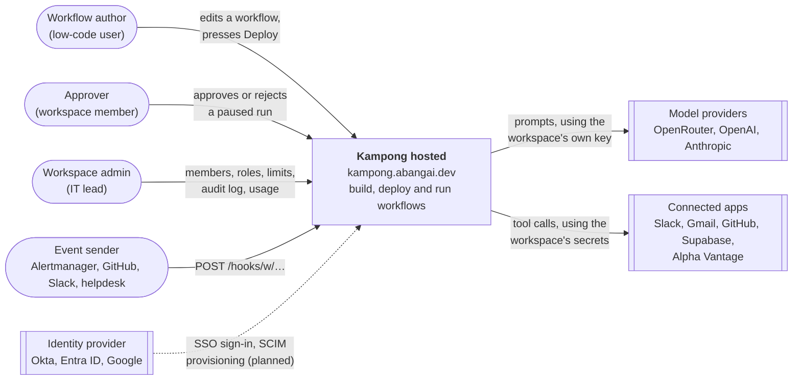
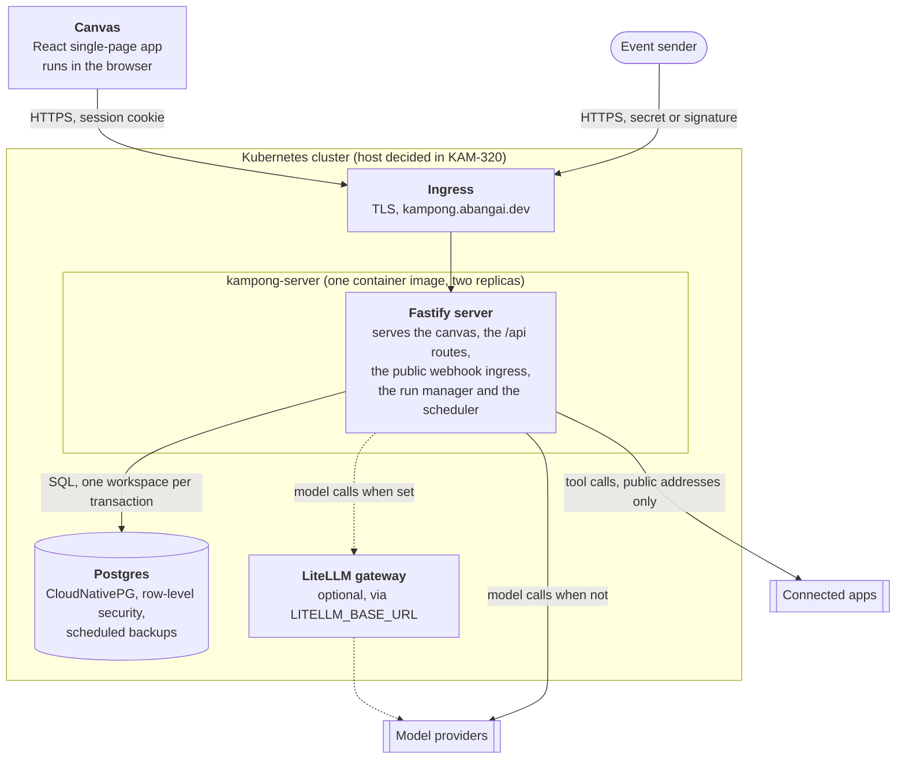
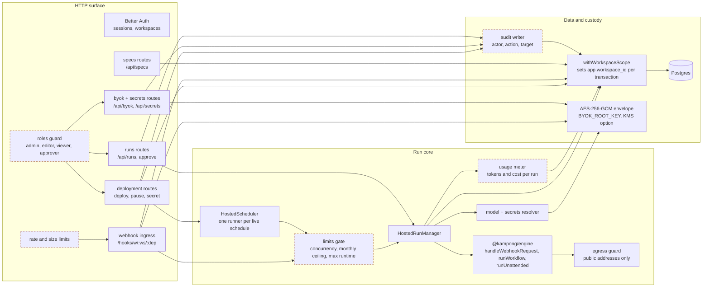
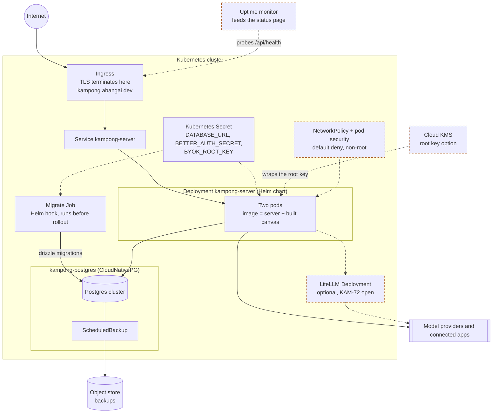

# Architecture

## System context

Three kinds of people and systems touch a deployment: the author who deploys it, the approver who unblocks it
and the sender whose events start it. A fourth, the workspace administrator, manages people and limits.
Model providers and connected apps are called with the workspace's own keys.

## Containers

One container image serves the canvas, the API, the public ingress, the run manager and the scheduler. That is
deliberate (ADR-0013): at this scale a separate static tier or worker fleet adds cost with no benefit. The
LiteLLM gateway is optional; without it the server calls providers directly. Which cluster hosts it is decided
in KAM-320.

## Components inside the server

Every database read goes through `withWorkspaceScope`, which pins one workspace per transaction so row-level
security does the isolation. The ingress is the only route with no session; it proves the caller with the
deployment's secret and hands the decision to the engine's own webhook handler. The dashed boxes are the
additions the enterprise epic needs: a limits gate in front of the run manager, an audit writer behind every
mutating route, a roles guard on those routes and a usage meter on every run.

## Infrastructure

A replica set of two behind one ingress, a migrate job that runs before each rollout, and a CloudNativePG
cluster with scheduled backups to an object store. Three secrets are needed at runtime. The planned additions
are a default-deny network policy, pod security settings, a KMS for the root key, and uptime monitoring that
feeds the status page. A restore drill (KAM-329) is what turns "the chart has backups" into "backups work".

