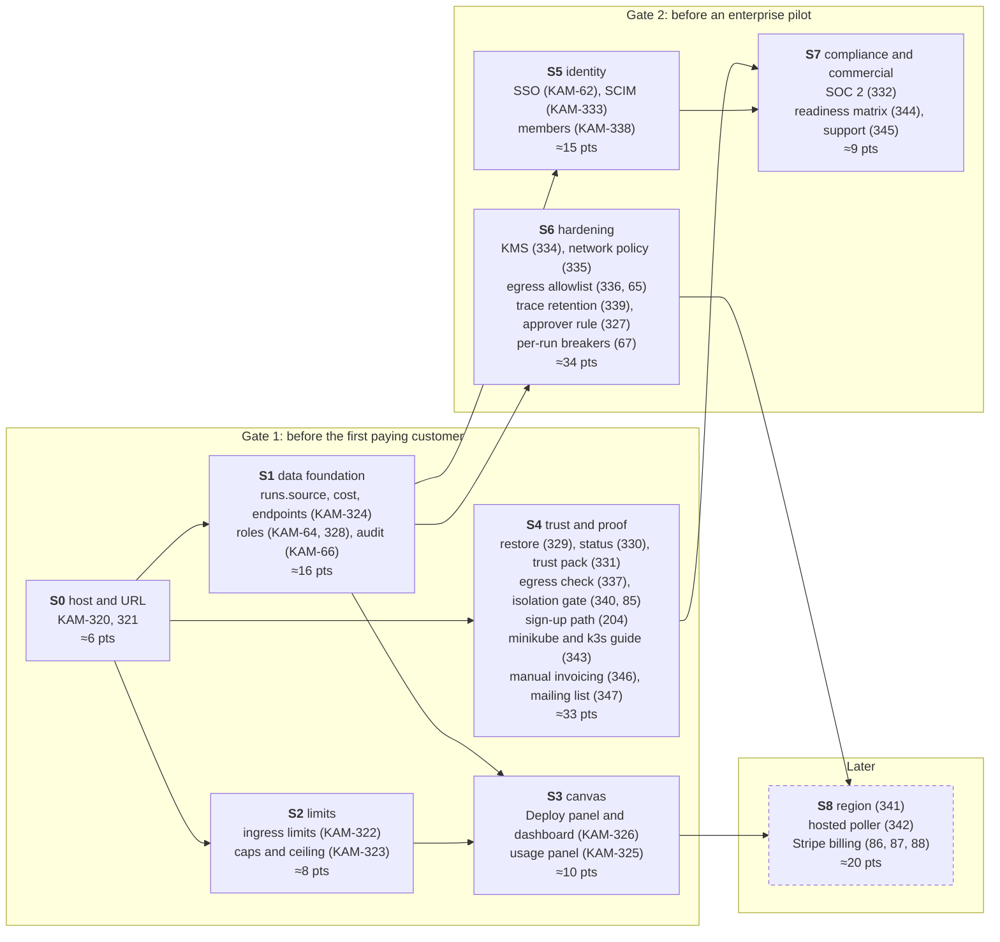

# Build plan

The first version of this plan was about 12 points in five slices. With the enterprise gaps filed it is about
151 points: 73 to be ready for a first paying customer, 58 more before an enterprise pilot, and 20 that can
wait. Points are the author's estimates and cover epic KAM-E45, which holds 28 new cards and 10 existing ones.

Owner decisions of 2026-11-25 shaped it: first customers run on the homelab as a labelled preview with no SLA;
people can also self-host and try it locally on minikube or k3s, so the install guide moved into gate 1; first
customers are invoiced by hand, so Stripe moved to later; and interest is gauged with a mailing list before
more is built.

## Slices and dependencies

Work in the first-customer gate comes first. Two lanes run in parallel: the product lane (data foundation,
then canvas) and the safety lane (limits, trust, operations). Identity and hardening start once the data
foundation lands, since roles and audit are what SSO and SCIM attach to.



| Slice | Done when                                                                                                                                                                           | Points |
| ----- | ----------------------------------------------------------------------------------------------------------------------------------------------------------------------------------- | ------ |
| S0    | `https://kampong.abangai.dev` serves the app over TLS on two replicas; the host choice is an ADR; webhook URLs use `PUBLIC_BASE_URL`                                                  | ≈6     |
| S1    | One migration adds `runs.source`, `deployed_by`, `triggered_by`, tokens and cost; list-runs and pending-approvals endpoints exist; roles guard every mutating route; audit events are written and readable | ≈16 |
| S2    | A burst over the limit gets 429 and starts no runs; a spent workspace pauses with a visible reason; a runaway run is stopped and recorded                                           | ≈8     |
| S3    | A browser test deploys, fires the webhook, sees the run and its cost, and approves a pending step; works in light, dark and at phone width                                         | ≈10    |
| S4    | A restore drill is timed and written up; a status page shows live uptime; the trust pages are published; a CI job fails on a seeded cross-tenant leak; a cold reader installs on minikube and k3s from the guide; invoices are produced by hand from a template; a mailing-list sign-up works | ≈33 |
| S5    | A test tenant at Okta or Entra signs in, is provisioned, and is deactivated with its sessions ended                                                                                  | ≈15    |
| S6    | A key rotation re-wraps all secrets with no downtime; the chart passes a policy check; an off-list host is refused; old traces are deleted by a job                                  | ≈34    |
| S7    | SOC 2 gap list has owners and a date; the readiness matrix is on the site; a support channel with response targets is published | ≈9 |
| S8    | Region stated; poll workflows run hosted; Stripe subscriptions gate Deploy | ≈20 |

## The Deploy panel

The panel is illustrative, not final design. It reuses the Trigger panel's Go live wording and adds the secret,
the run list and the approvals. A deployment that hit its ceiling shows a "limit reached" state with the
number and who can raise it.

```text
+--------------------------------------------------------------+
| Deploy                                                [Live] |
+--------------------------------------------------------------+
| Send events to                                               |
| https://kampong.abangai.dev/hooks/w/3f2a.../9c1d...   [Copy] |
| Secret                                                       |
| whsec_****************                              [Rotate] |
| Shown once when it is issued. Lost it? Rotate; the old one   |
| stops at once.                                               |
| [Redeploy]  [Pause]  [Delete]                                |
+--------------------------------------------------------------+
| Waiting for you (1)                                          |
| Post to Slack, run 7c2e                  [Approve] [Reject]  |
+--------------------------------------------------------------+
| This month: 412 runs, $38.20 of $200.00                      |
+--------------------------------------------------------------+
| Recent runs                                                  |
| webhook   14:02   Finished                                   |
| webhook   13:41   Finished, 1 of 3 items failed              |
| schedule  13:00   Failed                                     |
+--------------------------------------------------------------+
```

## Risks and open decisions

| Item                                    | Why it matters                                                                                              | Plan                                                                                          |
| --------------------------------------- | ----------------------------------------------------------------------------------------------------------- | --------------------------------------------------------------------------------------------- |
| No rate limit on the public ingress     | Anyone with the URL can start paid model runs; the body size is Fastify's default                           | KAM-322 before any paying customer; until then deploy only for trusted workspaces             |
| Where the server runs | A single homelab site has no SLA and no failover | Decided: homelab as a labelled preview with no SLA (KAM-320); move to a cloud host when a customer needs an SLA |
| Webhook URL host                        | The panel would build the address from the page origin                                                      | Decided: a `PUBLIC_BASE_URL` setting (KAM-321), default the request origin                    |
| Hosted e2e needs Docker                 | Docker is not available on the dev machine, so the full flow runs only in CI                                | Say so on the PR; KAM-340 runs it against a throwaway cluster in CI                           |
| Paused looks like missing               | Callers get 404; a person sees events stop and does not know why                                            | By design; the dashboard says so plainly, and a limit pause has its own state                 |
| Unsupported triggers                    | Poll and sync replies are refused at deploy                                                                 | Explain in the panel before Deploy is pressed; the poller is KAM-342                          |
| SOC 2 is long and not only engineering  | A report takes months of evidence; it cannot be sped up by building faster                                  | Start the readiness work in the pilot gate and publish the date                               |
| Billing is manual at first | A paying customer needs a way to pay | Decided: invoice by hand first (KAM-346); Stripe (KAM-86 to 88) and the pricing ADR (KAM-209) wait |
| Tenant isolation of in-process runs     | Isolation of the run environment and state store under concurrent runs was not verified                     | KAM-340 and KAM-85 test it adversarially before release                                       |
| Run history and trace retention         | The list reads the runs table; longer history waits on ADR-0064 and ADR-0065                                | Cap the list at 20 for now; retention is KAM-339                                              |

**Decisions made on 2026-11-25**

1. First customers run on the homelab as a labelled preview with no SLA. People can also self-host and try it
   locally on minikube or k3s (KAM-343, now in gate 1).
2. Manual invoicing first (KAM-346). Interest is gauged with a newsletter or mailing list (KAM-347) before more
   is built. Stripe waits.
3. Order inside gate 1: the recommendation was accepted. Ship the data migration (KAM-324) first, then audit
   (KAM-66) and roles (KAM-64, KAM-328) together in one slice, with the audit table first so a refused request
   is logged too. Limits (S2) run in parallel from the start, because the ingress limit is the cheapest
   protection against a leaked URL.

Also settled: the server is not running anywhere yet; it will live at `kampong.abangai.dev`; there is no
landing page for now; SSO and SCIM are in the plan.
