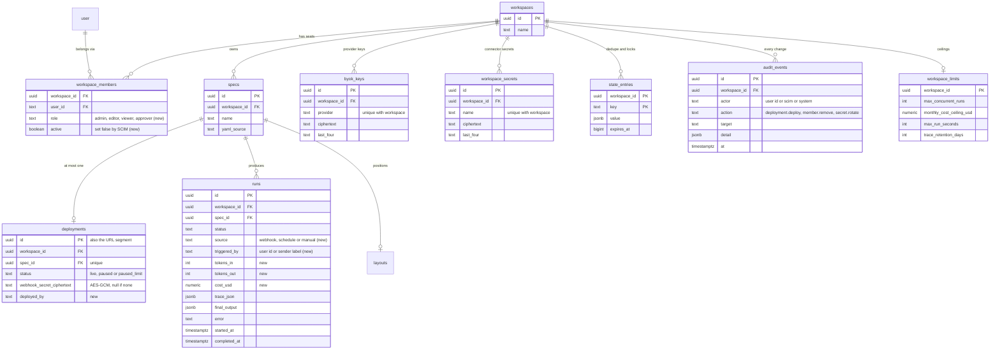
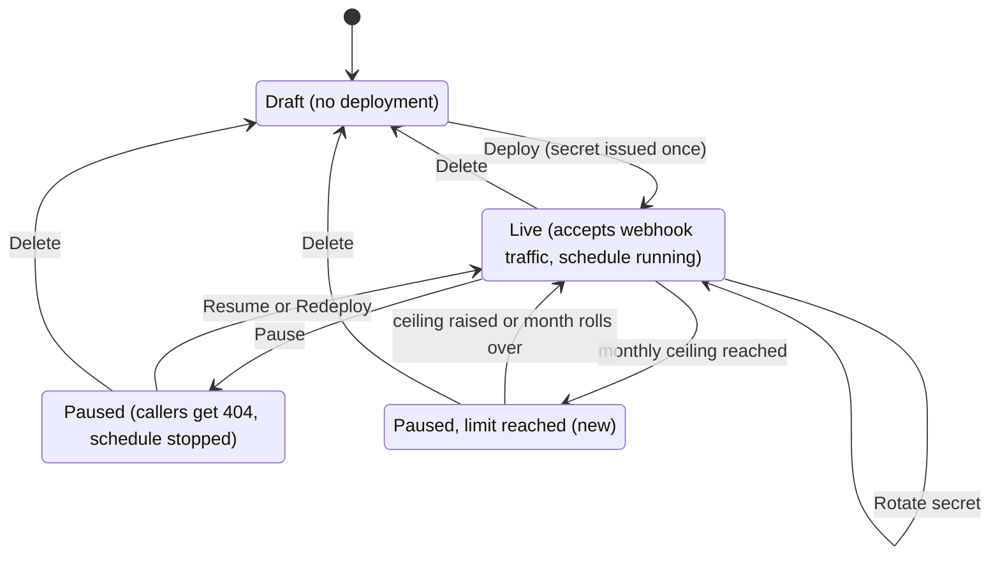
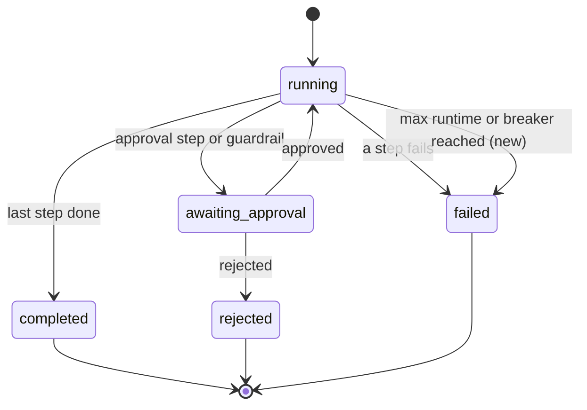
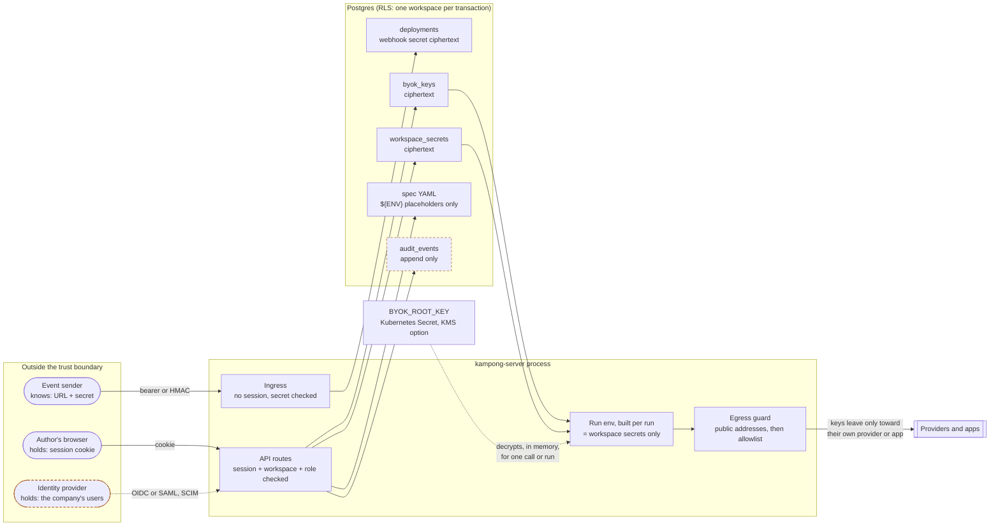
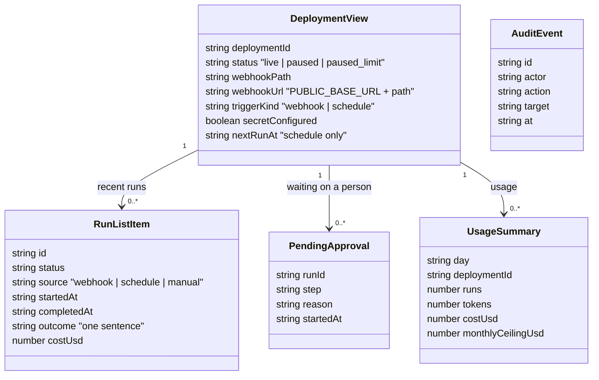

# Data and trust

## Data model

Everything hangs off `workspaces`. One deployment per spec, and its id is the unguessable URL segment. The
tables marked new in the diagram come from the enterprise epic. `runs` gains the columns every later feature
reads: how the run started, who deployed it, and what it cost (KAM-324). Billing is a separate set of tables
(KAM-86).

## Lifecycles

The deployment states are the ones the canvas must show. A paused deployment is invisible to callers, so the
dashboard is the only place a person learns that is why events stopped arriving. A deployment that reaches
its monthly ceiling pauses itself with its own state, so the dashboard can say "limit reached" and not just
"paused".

## Trust boundaries and where secrets live

Specs hold only `${ENV}` placeholders. Every real secret is ciphertext under one root key held in the cluster,
decrypted in memory for one call or run, and never placed in the server process's own environment where a
tenant's spec could read it (ADR-0056). The enterprise epic adds a KMS behind the root key, a per-workspace
egress allowlist and an identity provider on the sign-in side.

### Egress coverage

The egress guard (ADR-0058) now sits in front of all three ways a hosted run reaches the network (KAM-337):

| Path                          | What sends it                                        | Guarded by                                   |
| ----------------------------- | ---------------------------------------------------- | -------------------------------------------- |
| Tool HTTP                     | the engine's tool fetch                              | the guard                                    |
| First-party connectors        | the same fetch, handed to each component             | the guard                                    |
| Model provider calls          | the model client's fetch (`agent.model.base_url`)    | the guard, with the operator's LiteLLM host allowed |

The model path was the gap: a spec can name its own `agent.model.base_url`, and before KAM-337 that request went out
unguarded, so a tenant could aim the server at the metadata address or the cluster. A refusal fails the step with a
message naming the origin and is written to the audit log as `egress.blocked` (actor `system`, outcome `deny`,
target the origin only, never a path or query).

Two limits remain. The guard checks where a request goes, not what it carries, and there is no per-workspace
allowlist yet (KAM-336). The connector path is covered because it shares the tool fetch; it has no test of its
own beyond the guard's.

## Roles

Four roles, checked on every session route (KAM-64, KAM-328, `packages/server/src/auth/roles.ts`). A route names the
permission it needs and the check lives in one place, so a new route cannot skip it. A refusal is a 403 that names
the permission.

| Permission            | admin | editor | approver | viewer |
| --------------------- | :---: | :----: | :------: | :----: |
| `spec:read`           |  yes  |  yes   |   yes    |  yes   |
| `run:read`            |  yes  |  yes   |   yes    |  yes   |
| `deployment:read`     |  yes  |  yes   |   yes    |  yes   |
| `spec:write`          |  yes  |  yes   |          |        |
| `run:start`           |  yes  |  yes   |          |        |
| `deployment:manage`   |  yes  |  yes   |          |        |
| `approval:resolve`    |  yes  |  yes   |   yes    |        |
| `secret:read` (names) |  yes  |  yes   |          |        |
| `secret:write`        |  yes  |        |          |        |
| `byok:read`, `byok:write` | yes |      |          |        |
| `audit:read`          |  yes  |        |          |        |

Better Auth's own `owner` counts as admin and `member` as editor, so a workspace made before roles existed keeps
working. A member may hold several roles (comma-separated) and gets the union. Editors can approve by default so a
small team is not blocked; a separate-approver rule (four-eyes, KAM-327) comes later. Custom roles are not in scope.

## Audit log

Every change a person makes through the API, and every request a role refuses, is a row in `audit_events` (KAM-66).
The table is append only: row-level security allows select and insert for the workspace and nothing else, so an
update or delete through the application changes no rows.

- **Allowed changes** are written by one `onResponse` hook for every mutating session route that answers below 400,
  so a new route is audited without anyone remembering to. Failed attempts change nothing and are not recorded.
- **Refusals** are written where the role check fails, with the role and the permission that was missing. A refused
  read is recorded; an allowed read is not.
- **Contents:** who (`actor`, a user id), what (`action`, such as `secret.set` or `deployment.deploy`, otherwise
  `METHOD /route`), the `target` (the first path id or name), the outcome (`allow` or `deny`), and `detail` with the
  method, route, status, role, permission and the caller's address. Never a request body, so a secret value cannot
  reach it.
- **Export:** `GET /api/audit`, admins only, newest first. Filters `action`, `actor`, `outcome`, `since`, `until`;
  pages with `limit` (default 100, max 500) and `cursor`. The response carries `version: 1`; a breaking change bumps it.
- **Failure mode:** a failed audit write is logged and does not fail the request, so an audit-table outage cannot take
  the product down. A buyer who needs fail-closed can have it as an option later.
- **Egress blocks** are recorded as `egress.blocked` (KAM-337).
- **Not yet audited:** webhook-started runs (their source is on the run row), sign-in and member changes (they arrive with SSO and SCIM).

## API

| Route                                         | Who     | Does                                                                   | State        |
| --------------------------------------------- | ------- | ---------------------------------------------------------------------- | ------------ |
| `PUT /api/specs/:id/deployment`               | session | Deploy or redeploy; returns `webhookPath` and, once, `webhookSecret`   | exists       |
| `GET /api/specs/:id/deployment`               | session | Id and status today                                                    | extend (S2)  |
| `PATCH /api/specs/:id/deployment`             | session | Pause or resume                                                        | exists       |
| `DELETE /api/specs/:id/deployment`            | session | Remove the deployment                                                  | exists       |
| `POST /api/specs/:id/deployment/webhook-secret` | session | Rotate the secret (shown once)                                       | exists       |
| `POST /hooks/w/:ws/:dep`                      | secret  | Start a run; gains rate and size limits                                | exists, S7   |
| `POST /api/runs/:id/approve`                  | session | Approve or reject a paused run; needs `approval:resolve`               | exists       |
| `GET /api/specs/:id/runs?limit=`              | session | Recent runs of this spec, newest first                                 | new (S1)     |
| `GET /api/specs/:id/approvals`                | session | Runs of this spec waiting for a person                                 | new (S1)     |
| `GET /api/workspaces/:id/usage`               | session | Runs, tokens and cost by day and by deployment                         | new (S3)     |
| `GET /api/audit`                              | admin   | Audit events, filterable, versioned JSON for a SIEM (KAM-66)           | exists       |
| `/scim/v2/Users`, `/scim/v2/Groups`           | bearer  | Provision members from the identity provider (KAM-333)                 | new (pilot)  |

The shapes the dashboard needs, as new types:

