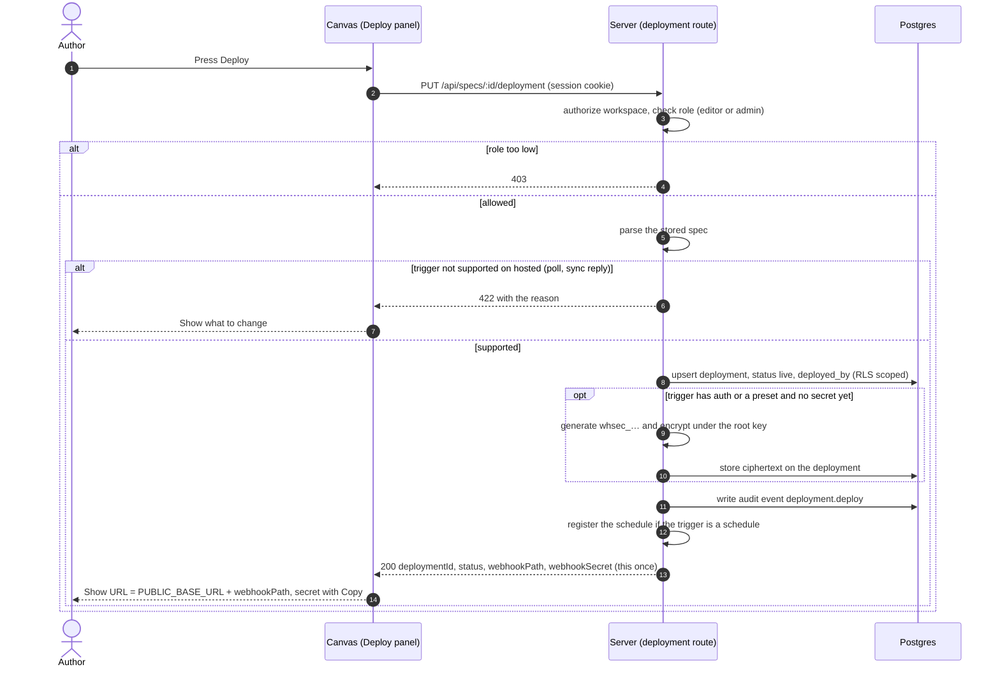
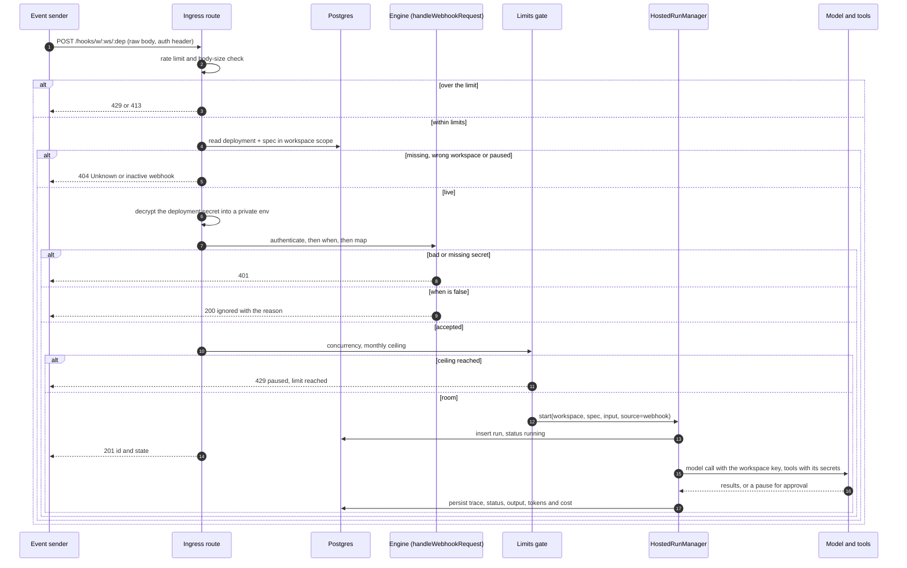
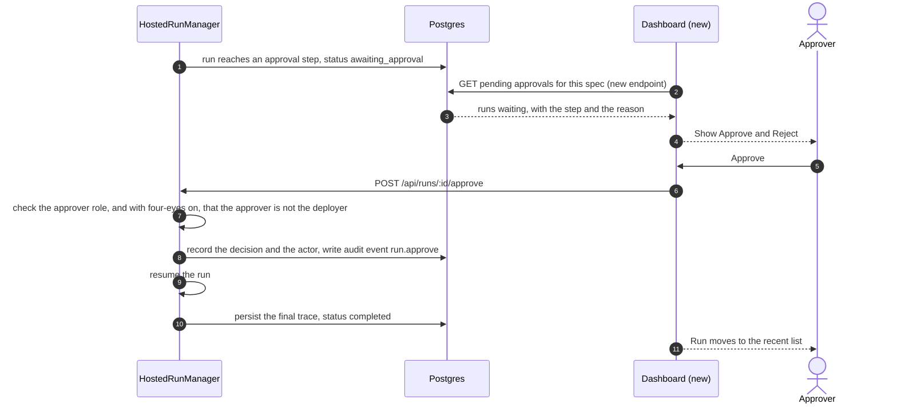
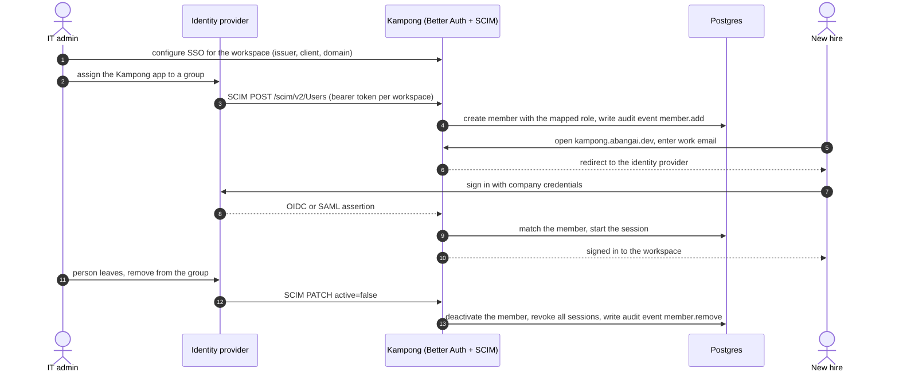
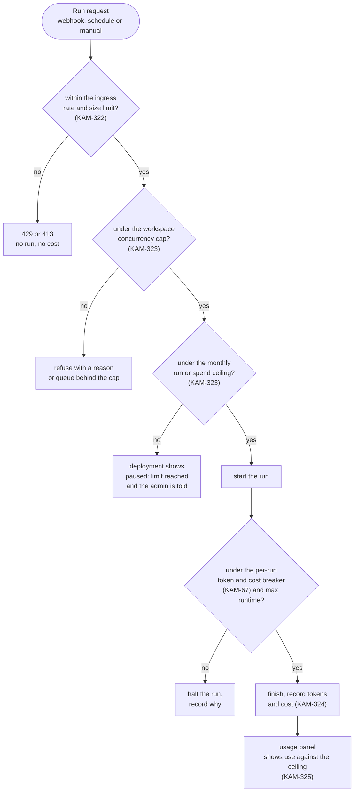
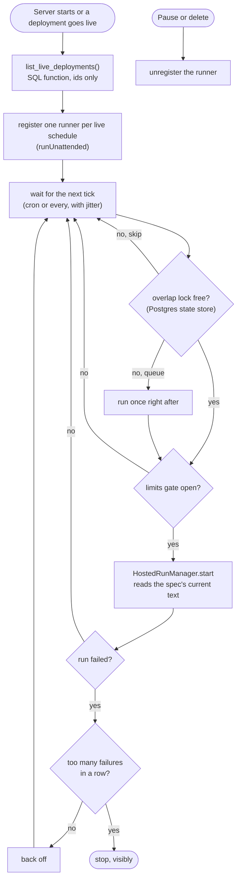
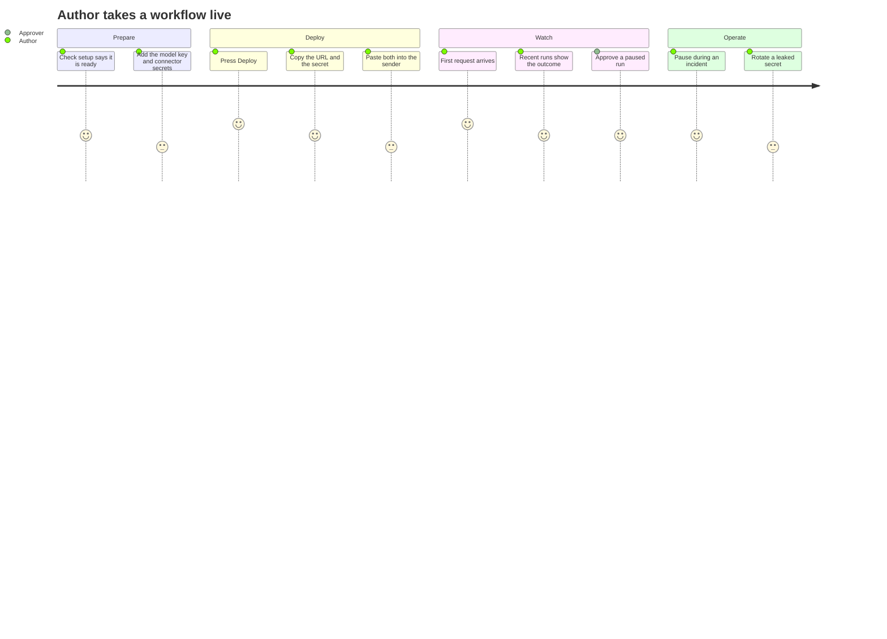
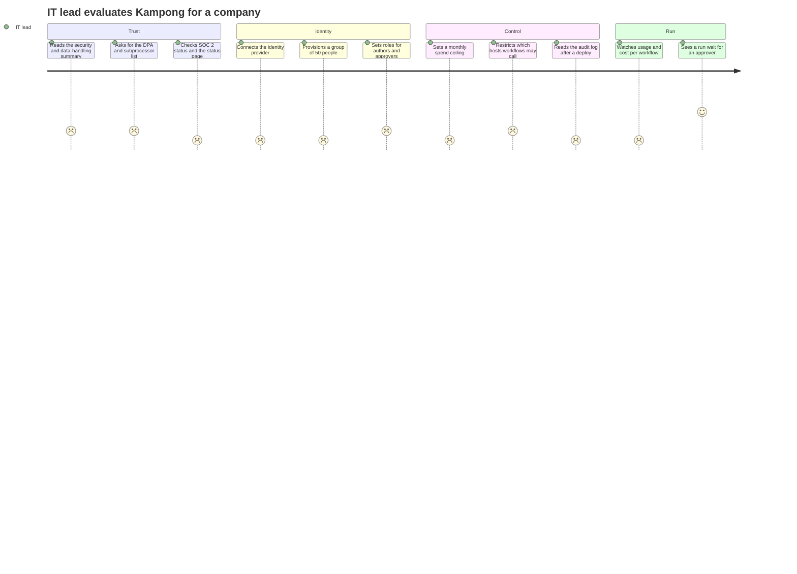

# Flows

## Deploy

Pressing Deploy refuses what hosted cannot run, checks the caller's role, issues the secret once, registers a
schedule and writes an audit event. Deploy is idempotent: a second press reactivates the same row and keeps the
same URL and secret. The secret appears in exactly one response, so the panel shows it with a Copy button and
says that it cannot be shown again.

## A webhook starts a run

A paused, missing or wrong-workspace deployment all answer the same 404, so a caller cannot tell them apart.
The reply is a run id, not the result: the run goes on in the server. The rate limit sits in front of
everything so a flood is turned away before it touches the database; the limits gate sits just before the run
starts so a spent workspace refuses new work with a stated reason.

## A run waits for a person

The run is already persisted as `awaiting_approval`; the dashboard only needs a read endpoint that lists those
rows. The decision uses the approve route that exists today, now behind a role check. A workspace can turn on
the four-eyes setting so that the person who deployed the workflow cannot approve its runs.

## Sign-in and provisioning (planned)

OIDC first, then SAML, then SCIM. A person from the customer's identity provider signs in through single
sign-on; SCIM creates, updates and deactivates members from the same provider. Removing someone there ends
their sessions in Kampong, which is the part security reviewers test first.

## Limits and runaway protection

Three separate limits protect the customer's model budget and the shared server. They answer different
questions, so they are separate cards: the ingress limit protects the server from floods, the workspace
ceiling protects the customer's bill, and the per-run limits stop one run from running away.

## Scheduler

A scheduled deployment is a runner per live row, with its overlap lock in the workspace's Postgres state
store so two replicas never fire one tick twice. That claim is asserted by the design and has not been shown
running on two replicas; KAM-320 and KAM-340 are where it gets proved. Changing a cadence needs a redeploy.
A scheduled tick goes through the same limits gate as a webhook.

## The author's journey

The panel is the Go live block from the local app (command, address, header, curl) grown into a dashboard:
the same words for the same things, with the secret and the run list added.

## The IT lead's evaluation

The second journey is the buyer's. Each low score is a gap on the [readiness page](enterprise-readiness.md);
the plan is to turn them all into fours and fives before a pilot.

